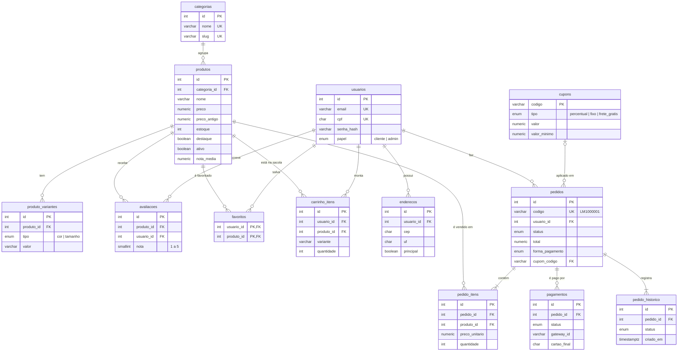

# Banco de dados — Lumen Store

Hoje a Lumen Store roda 100% no navegador e guarda tudo no `localStorage`. Este documento descreve **tudo o que seria necessário para a loja funcionar com um banco de dados real**, seguindo a mesma stack do projeto (JavaScript de ponta a ponta):

| Camada | Tecnologia | Papel |
|---|---|---|
| Front-end | React 18 + Vite | Telas (já prontas neste repositório) |
| Back-end | Node.js + Express | API REST entre o site e o banco |
| Banco | **PostgreSQL 16** | Dados relacionais: produtos, clientes, pedidos |
| Acesso ao banco | `pg` (node-postgres) | Consultas SQL com parâmetros (`$1, $2…`) |
| Segurança | `bcrypt` + JWT | Hash de senha e sessão do usuário |
| Ambiente local | Docker Compose + Adminer | Sobe o banco e uma interface web com um comando |

**Por que PostgreSQL?** Um e-commerce é naturalmente relacional: pedido tem itens, item aponta para produto, produto pertence a categoria. O PostgreSQL garante isso com chaves estrangeiras, restrições (`CHECK`) e **transações**, que impedem, por exemplo, que dois clientes comprem a última unidade ao mesmo tempo.

---

## Arquivos

```
database/
├── schema.sql    # tabelas, tipos, índices, gatilhos e visões
├── seed.sql      # dados iniciais (o mesmo catálogo do site + usuários e pedido de exemplo)
└── queries.sql   # as consultas que cada tela da loja faria
docker-compose.yml  # PostgreSQL + Adminer prontos para uso
```

---

## Como subir o banco

### Com Docker (recomendado)
```bash
docker compose up -d
```
- O esquema e os dados de exemplo são carregados automaticamente na primeira vez.
- Banco: `localhost:5432` · banco `lumen_store` · usuário `lumen` · senha `lumen123`
- Adminer (ver as tabelas pelo navegador): **http://localhost:8080** → Sistema *PostgreSQL*, Servidor `db`
- Para apagar tudo e recomeçar: `docker compose down -v`

### Com PostgreSQL instalado no computador
```bash
createdb lumen_store
psql -d lumen_store -f database/schema.sql
psql -d lumen_store -f database/seed.sql
```

### Usuários de demonstração
| Papel | E-mail | Senha |
|---|---|---|
| Administrador | admin@lumenstore.com.br | lumen123 |
| Cliente | maria@exemplo.com | lumen123 |

---

## Diagrama entidade-relacionamento



> O GitHub desenha esse diagrama automaticamente.

---

## Dicionário das tabelas

| Tabela | O que guarda | Destaques |
|---|---|---|
| `categorias` | Tecnologia, Moda, Acessórios, Casa | `slug` usado na URL e nos filtros |
| `produtos` | Catálogo | `CHECK (estoque >= 0)` impede estoque negativo; `ativo = false` em vez de apagar |
| `produto_variantes` | Cores e tamanhos | Um produto pode ter várias opções |
| `usuarios` | Clientes e administradores | Senha só como **hash bcrypt**; e-mail único sem diferenciar maiúsculas |
| `enderecos` | Endereços de entrega | Só um endereço `principal` por usuário (índice único parcial) |
| `favoritos` | Produtos salvos | Chave primária composta (usuário + produto) |
| `carrinho_itens` | Sacola persistente | A sacola acompanha o cliente em qualquer aparelho |
| `avaliacoes` | Notas de 1 a 5 | Gatilho recalcula `nota_media` do produto |
| `cupons` | BEMVINDO10, FRETEGRATIS, LUMEN50 | Validade, valor mínimo e limite de usos |
| `pedidos` | Cabeçalho do pedido | Guarda **cópia do endereço**; `CHECK` confere se o total fecha a conta |
| `pedido_itens` | Produtos de cada pedido | Guarda **nome e preço do momento da compra** |
| `pedido_historico` | Linha do tempo | Preenchida sozinha por gatilho a cada mudança de status |
| `pagamentos` | Pix, cartão, boleto | Do cartão, só bandeira e 4 últimos dígitos (regra PCI-DSS) |

### Visões (relatórios do painel admin)
| Visão | Usada em |
|---|---|
| `vw_kpis` | Cartões de faturamento, pedidos, ticket médio e valor em estoque |
| `vw_vendas_por_categoria` | Gráfico "Vendas por categoria" |
| `vw_mais_vendidos` | Ranking "Mais vendidos" |
| `vw_estoque_baixo` | Alerta de produtos com 5 unidades ou menos |
| `vw_pedidos_pagos` | Base das outras: pedidos que não estão aguardando nem cancelados |

### Regras automáticas (gatilhos)
- **`trg_*_atualizado`**: atualiza `atualizado_em` em toda alteração.
- **`trg_avaliacoes_nota`**: recalcula a nota média e o total de avaliações do produto.
- **`trg_pedidos_historico`**: grava cada mudança de status em `pedido_historico`.

---

## Do localStorage para o banco

O estado atual do site (`db` em `src/App.jsx`) vira tabelas assim:

| No front-end hoje | No banco |
|---|---|
| `db.products` | `produtos` + `categorias` + `produto_variantes` |
| `db.cart` | `carrinho_itens` |
| `db.favs` | `favoritos` |
| `db.orders` | `pedidos` + `pedido_itens` + `pagamentos` + `pedido_historico` |
| `db.cupom` | validado na tabela `cupons` e gravado em `pedidos.cupom_codigo` |
| `db.cep` | `enderecos.cep` |
| `COUPONS` em `lib/utils.js` | tabela `cupons` |
| `STATUS` (índices 0 a 4, −1) | tipo `status_pedido` (`aguardando_pagamento` … `cancelado`) |

---

## API REST planejada (Node.js + Express)

| Método | Rota | Descrição | Consulta em `queries.sql` |
|---|---|---|---|
| `GET` | `/api/produtos?categoria=&max=&ofertas=&estoque=&busca=&ordem=` | Catálogo com filtros | 1.1 |
| `GET` | `/api/categorias` | Categorias com contagem | 1.2 |
| `GET` | `/api/produtos/:id` | Detalhe + variantes | 2.1 |
| `GET` | `/api/produtos/:id/avaliacoes` | Avaliações | 2.2 |
| `POST` | `/api/produtos/:id/avaliacoes` | Avaliar (só quem recebeu o produto) | 2.4 |
| `POST` | `/api/auth/cadastro` | Criar conta | 7.2 |
| `POST` | `/api/auth/login` | Login → devolve token JWT | 7.1 |
| `GET` / `POST` / `DELETE` | `/api/favoritos` | Favoritos do cliente | 3.x |
| `GET` / `POST` / `PATCH` / `DELETE` | `/api/carrinho` | Sacola | 4.x |
| `POST` | `/api/cupons/validar` | Validar cupom | 4.4 |
| `POST` | `/api/frete` | Calcular frete pelo CEP | — |
| `POST` | `/api/pedidos` | **Checkout** (transação completa) | 5.x |
| `GET` | `/api/pedidos` | Meus pedidos com linha do tempo | 6.1 |
| `POST` | `/api/pedidos/:id/cancelar` | Cancelar e devolver estoque | 6.3 |
| `POST` | `/api/webhooks/pagamento` | Confirmação do Mercado Pago/Stripe | 6.2 |
| `GET` | `/api/admin/resumo` | KPIs e relatórios *(admin)* | 8 |
| `POST` / `PATCH` / `DELETE` | `/api/admin/produtos` | CRUD de produtos *(admin)* | 8.1–8.3 |
| `GET` / `PATCH` | `/api/admin/pedidos` | Pedidos e status *(admin)* | 8.4–8.5 |

### Exemplo: conexão e checkout com transação
```js
// server/db.js
import pg from 'pg';
export const pool = new pg.Pool({ connectionString: process.env.DATABASE_URL });

// server/routes/pedidos.js
router.post('/', autenticar, async (req, res) => {
  const client = await pool.connect();
  try {
    await client.query('BEGIN');
    const { rows: itens } = await client.query(SQL_TRAVA_SACOLA, [req.usuario.id]);
    if (itens.some(i => i.estoque < i.quantidade)) throw new Error('Estoque insuficiente');

    const valores = calcularTotais(itens, req.body.cupom, req.body.cep, req.body.pagamento); // no servidor!
    const { rows: [pedido] } = await client.query(SQL_CRIA_PEDIDO, [req.usuario.id, ...valores]);
    await client.query(SQL_COPIA_ITENS,   [pedido.id, req.usuario.id]);
    await client.query(SQL_BAIXA_ESTOQUE, [pedido.id]);
    await client.query(SQL_LIMPA_SACOLA,  [req.usuario.id]);

    await client.query('COMMIT');
    res.status(201).json(pedido);
  } catch (erro) {
    await client.query('ROLLBACK');
    res.status(400).json({ erro: erro.message });
  } finally {
    client.release();
  }
});
```

### Dependências do back-end
```bash
npm install express pg bcrypt jsonwebtoken cors dotenv zod
npm install -D nodemon
```
| Pacote | Para quê |
|---|---|
| `express` | Servidor e rotas da API |
| `pg` | Conexão com o PostgreSQL |
| `bcrypt` | Hash e verificação de senha |
| `jsonwebtoken` | Token de login (JWT) |
| `cors` | Permitir que o site em `localhost:5173` chame a API |
| `dotenv` | Ler o `.env` (`DATABASE_URL`, `JWT_SECRET`) |
| `zod` | Validar os dados que chegam nas requisições |
| `nodemon` | Reiniciar o servidor ao salvar (desenvolvimento) |

---

## Segurança

- **Senhas**: somente hash `bcrypt`, nunca em texto puro.
- **SQL injection**: sempre consultas com parâmetros (`$1`), nunca concatenando texto do usuário.
- **Preços e totais**: recalculados no servidor; o front-end só envia IDs e quantidades.
- **Cartão de crédito**: o número completo e o CVV vão direto para o gateway (Mercado Pago/Stripe), que devolve um token. O banco guarda só bandeira e 4 últimos dígitos.
- **Admin**: rotas `/api/admin/*` exigem `papel = 'admin'` no token.
- **Concorrência**: `SELECT … FOR UPDATE` no checkout trava o estoque até o fim da transação.
- **Segredos**: `DATABASE_URL` e `JWT_SECRET` ficam no `.env`, que não vai para o Git.
- **LGPD**: CPF, e-mail e endereço são dados pessoais; acesso restrito e exclusão de conta sob pedido.

---

## Próximos passos

1. Criar a pasta `server/` com Express e as rotas acima
2. Trocar o `localStorage` do `App.jsx` por chamadas `fetch('/api/...')`
3. Tela de login e cadastro
4. Integrar o Mercado Pago (Pix e cartão) com webhook de confirmação
5. Consultar o CEP real com a API do ViaCEP
6. Migrations versionadas (ex.: `node-pg-migrate`) no lugar de rodar o `schema.sql` à mão
7. Deploy do banco em serviço gerenciado (Supabase, Neon ou Railway)
